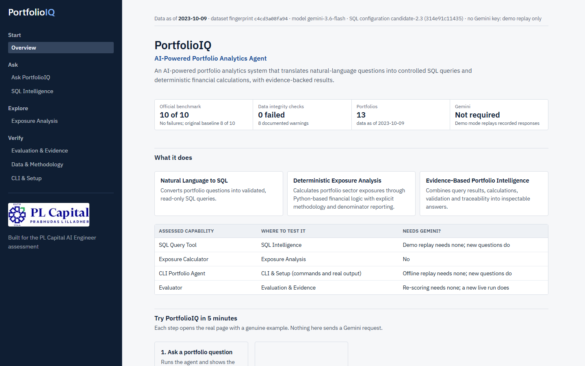
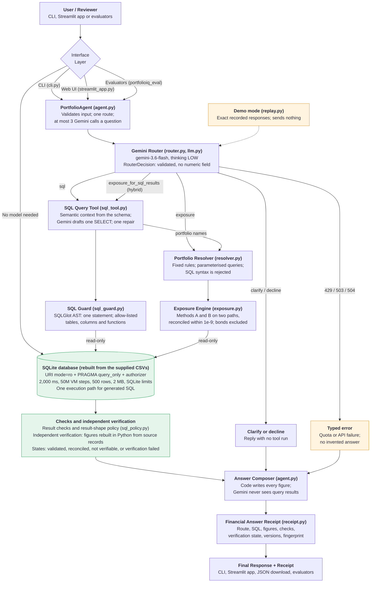

# PortfolioIQ

**AI-Powered Portfolio Intelligence & Analytics.** *Trustworthy Financial Intelligence, Not Just AI Answers.*

PortfolioIQ answers plain-English questions about a portfolio database. A Gemini-backed agent chooses
between a text-to-SQL tool and a deterministic sector exposure calculator, and every answer carries a
**Financial Answer Receipt**: where the figures came from, how they were calculated and what was
actually verified. Gemini chooses tools and drafts SQL; **code computes every figure and writes every
answer**. A Streamlit workspace, a command-line interface and an evaluation framework all run on the
same backend.

> **Status.** The active SQL configuration is `candidate-2.3` (SQL prompt `314e91c11435`), on `gemini-3.6-flash`. Live on the unchanged official
> evaluator it scored **10 of 10**, against **8 of 10** for the original baseline, which is kept and can be restored with
> `PORTFOLIOIQ_SQL_PROMPT=baseline`. On a frozen held-out set it scored **16 of 16** in one run. These are small samples: see
> [what the results mean](#what-the-results-mean).



## Contents

- [Assignment coverage](#assignment-coverage)
- [Quick start](#quick-start)
- [Gemini API configuration](#gemini-api-configuration)
- [Demonstration workflow](#demonstration-workflow)
- [What it does](#what-it-does)
- [Architecture & Overview](#architecture--overview)
- [Financial methodology](#financial-methodology)
- [Security design](#security-design)
- [Evaluation results](#evaluation-results)
- [Known limitations](#known-limitations)
- [Command reference](#command-reference)
- [Repository layout and documents](#repository-layout-and-documents)

## Assignment coverage

| Requirement | Implementation | Files |
|---|---|---|
| SQL Query Tool | Natural language to one validated, read-only `SELECT` | `src/portfolioiq/sql_tool.py`, `sql_guard.py`, `sql_engine.py`, `semantic.py` |
| Exposure Calculator | Sector weights by two labelled methods, bonds excluded, computed twice and reconciled | `src/portfolioiq/exposure.py` |
| Portfolio Agent (CLI) | Routes each question to a tool, or asks for clarification, or declines | `src/portfolioiq/agent.py`, `router.py`, `cli.py` |
| Evaluator | Executed-result comparison against the supplied ground truth | `src/portfolioiq_eval/comparator.py`, `official.py`, `sql_eval.py` |
| Documentation and error handling | This README, typed errors for quota, outage, invalid output and invalid SQL | `docs/`, `src/portfolioiq/llm.py` |
| Optional UI | Streamlit application with seven pages | `app/` |

**Technology.** Python 3.12 or later, SQLite, Google Gemini (`google-genai`), SQLGlot, Pydantic, Streamlit, pandas, pytest.

## Quick start

Requires Python 3.12 or later (tested on Python 3.12 and 3.13 on Windows 11; CI runs Python 3.12 on Linux and Windows).

```bash
git clone https://github.com/codebyAtharva09/PLCapital-PortfolioIQ.git
cd PLCapital-PortfolioIQ
python -m venv .venv
# Windows (PowerShell): .venv\Scripts\Activate.ps1      macOS/Linux: source .venv/bin/activate
python -m pip install -r requirements.txt               # also installs this project in editable mode
pytest                                                  # offline tests, no network, no API key needed
streamlit run app/streamlit_app.py                      # opens http://localhost:8501
python -m portfolioiq ask --replay "How many holdings does the Dividend Aristocrats Fund have?"  # the CLI, no key needed
```

The database builds itself from `data/` on first use, so there is no separate initialisation step.

On Windows, if PowerShell refuses to run `Activate.ps1`, either run
`Set-ExecutionPolicy -Scope Process Bypass` first or call the tools directly, for example
`.venv\Scripts\python -m pytest` and `.venv\Scripts\python -m streamlit run app/streamlit_app.py`.


No API key is needed to explore the app. Overview, Exposure Analysis, Evaluation & Evidence, Data &
Methodology and CLI & Setup are deterministic, and Ask PortfolioIQ and SQL Intelligence open in a clearly
labelled **demo mode** that replays recorded Gemini responses (see below). A key is needed only to ask new
questions live. A timed walkthrough with screenshots is in [docs/REVIEWER_GUIDE.md](docs/REVIEWER_GUIDE.md).

The supplied data files are byte-identical to the originals. Check them at any time:

```bash
python -m portfolioiq integrity          # 22 database-wide checks; check I01 compares data/SHA256SUMS
```

## Gemini API configuration

PortfolioIQ uses Google's official `google-genai` SDK (pinned to 2.34.0) and the model
`gemini-3.6-flash`. The key is read **only** from the `GEMINI_API_KEY` environment variable or from a
git-ignored `.env` file. It is never printed, logged or written to reports.

```powershell
# Windows PowerShell, current session only
$env:GEMINI_API_KEY = "<your key>"
```

```bash
# macOS/Linux, current shell only
export GEMINI_API_KEY="<your key>"
```

`PORTFOLIOIQ_SQL_PROMPT` selects the SQL configuration. It defaults to the active `candidate-2.3`;
`baseline` rolls back to the original configuration.

Or copy `.env.example` to `.env` and put the key there. `.env` is ignored by git; never put a real key
in `.env.example`. `GEMINI_MODEL` overrides the model (there is no silent fallback to another model).

On Google's free tier `gemini-3.6-flash` allows 5 requests a minute and **20 a day** per project.
A question costs at most three requests (route, SQL draft, one repair). Every request, failed ones
included, is logged to `reports/api_usage.jsonl`. Identical requests are answered from saved
responses at no cost.

## Demonstration workflow

A 10-minute walkthrough that needs **no API key and no network**:

1. `streamlit run app/streamlit_app.py`. **Overview**: what the system does, the answer path, the
   dataset snapshot and the five-minute test.
2. **Exposure Analysis**: choose *Balanced Portfolio*. Warnings first, then Method A (bonds 64% shown
   as excluded) and Method B (61.11% Technology) with their numerators and denominators, and the
   **Independently reconciled** stamp. Then choose *Fixed Income Plus*: "No eligible stocks", nothing invented.
3. **Ask PortfolioIQ**, demo mode: run *"Which high-risk portfolio has the largest Technology
   exposure?"*. Gemini's routing decision and SQL draft are replayed from recorded responses; the SQL
   runs now and the exposure engine ranks the four portfolios. Open **View Calculation & Evidence** for
   the receipt. Type any other question: demo mode says no recorded response exists and invents nothing.
4. **SQL Intelligence**: the generated SQL, the guard's verdict check by check, the rows, and a guard
   test bench that validates fixed unsafe statements without executing them.
5. **Evaluation & Evidence**: the active production result, the original baseline with its Q5 and Q7
   failures, candidate history including the failed v2.2, supplemental and security sections, and an
   offline re-score button.
6. **Data & Methodology**: definitions, known limitations and the 22 invariant checks.
7. **CLI & Setup** and the terminal: `python -m portfolioiq exposure "international equity"` and
   `python -m portfolioiq ask --replay "How many holdings does the Dividend Aristocrats Fund have?"`.

With a key configured, switch Ask PortfolioIQ to **Live Gemini** (or use `python -m portfolioiq ask`).

## What it does

| Component | What it does | Gemini? |
|---|---|---|
| **Portfolio Agent** | One validated routing decision per question: `sql`, `exposure`, `exposure_for_sql_results` (SQL finds portfolios, exposure for each), `clarify` or `decline`. The answer text is composed by code from tool results | Routing only |
| **SQL Query Tool** | Gemini drafts one SQLite `SELECT` from a semantic description of the schema. The query must pass a SQLGlot guard, then runs read-only under a SQLite authorizer, a time limit and a row cap | Draft only |
| **Sector Exposure Calculator** | Method A and Method B from `holdings.current_weight`, bonds excluded, residual shown, computed twice (Python and SQL) and reconciled | No |
| **Portfolio resolver** | Deterministic name resolution: full names, the approved alias `tech`, distinctive phrases; generic words ask for clarification; typos give suggestions; SQL syntax is rejected | No |
| **Financial Answer Receipt** | Route, tool calls, SQL, exposure figures, checks, verification state, caveats, model and SDK, requests, tokens, timings, data fingerprint, prompt versions | No |
| **Financial Invariant Engine** | 22 database-wide checks (PASS / WARNING / FAIL / N/A): checksums, foreign keys, weights, prices, AUM coverage, reconciliation, coverage, classification, dates | No |
| **Evaluators** | SQL execution accuracy (strict and relaxed), agent integration, official Q1-Q10 on three layers, a 19-scenario reliability benchmark, API usage | Live runs only |
| **Independent financial verification** | Rebuilds market value, AUM, cost basis, weights and percentages from source records in plain Python, and compares them with the SQL result. The generated SQL is never re-run to check itself | No |
| **Streamlit app** | Seven pages: Overview, Ask PortfolioIQ, SQL Intelligence, Exposure Analysis, Evaluation & Evidence, Data & Methodology, CLI & Setup | Ask and SQL pages only, in Live mode |
| **Demo mode** | Replays recorded Gemini responses offline, labelled **DEMO / FIXTURE MODE**; everything after the model output runs now | Never sends a request |

**Verification states.** `INDEPENDENTLY_RECONCILED` (two independent calculations agree), `RESULT_VALIDATED` (the result passed
every check and has no calculated figure), `NOT_INDEPENDENTLY_VERIFIABLE` (a calculated figure could not be rebuilt from source
records, so nothing is claimed about it), `VERIFICATION_FAILED` (a check failed; figures must not be used) and
`VERIFICATION_UNAVAILABLE` (nothing to verify, for example a refusal).
Correctness against a reference answer is judged separately by the evaluators.

## Architecture & Overview

PortfolioIQ separates what the model may decide from what code must do. Gemini chooses a route and drafts SQL. Python validates the
query, runs it read-only, performs the calculations, checks the result and writes the answer. Gemini never receives query results.



Purple boxes are application components, green boxes are data and verification controls, and amber boxes are demo mode or the failure path. Only the router and the SQL draft call Gemini. Use the diagram's controls to zoom and pan.

Following one question through the diagram:

| Stage | What happens | Gemini? |
|---|---|---|
| **1. Interface** | The CLI, the Streamlit app and the evaluators call the same agent. Exposure Analysis and the data checks read the database directly | No |
| **2. Agent and router** | The agent validates the input. One request returns a validated decision: `sql`, `exposure`, `exposure_for_sql_results`, `clarify` or `decline`. The decision has no numeric field, so no figure can travel from the model into an answer | Yes, routing |
| **3. SQL path** | Gemini drafts one `SELECT` from a semantic description of the schema. The SQLGlot guard checks that exact text, then SQLite runs it read-only under an authorizer and time, step, row and size limits | Yes, the draft and at most one repair |
| **4. Exposure path** | The resolver matches the portfolio by fixed rules. The engine calculates Methods A and B on two independent paths and requires them to agree within 1e-9 | No |
| **5. Hybrid path** | `exposure_for_sql_results`: SQL finds the portfolios, and the exposure engine runs for each name returned | SQL draft only |
| **6. Clarify, decline or failure** | No tool runs for a clarification or a decline. A quota or API failure becomes a typed error, and no answer is invented. Demo mode replays exact recorded responses and sends nothing | Routing only |
| **7. Verification and answer** | Result checks run first, then figures are rebuilt in Python from source records where the data allows it. Code writes the answer, and the receipt records the route, SQL, figures, checks, verification state and versions | No |

- **Runtime package** `src/portfolioiq/`: `agent.py`, `router.py`, `sql_tool.py`, `sql_guard.py`,
  `sql_engine.py`, `semantic.py`, `dates.py`, `exposure.py`, `resolver.py`, `invariants.py`,
  `receipt.py`, `llm.py` (the only module that talks to Gemini), `replay.py` (demo mode), `cli.py`.
- **Evaluation package** `src/portfolioiq_eval/`: comparator, SQL evaluation, agent integration,
  official evaluation, reliability benchmark, usage summary. Runtime code never imports it and never
  reads the ground truth (both enforced by tests).
- **App** `app/`: `streamlit_app.py` (navigation), `backend.py` (cached access to the shared
  backend), `evidence.py` (receipt and SQL-safety display), `ui.py` (components), `views/` (one module per page).
- The database is built from the supplied `database_schema.sql` (run unmodified) and CSVs into a
  cached SQLite file named by the data fingerprint; it is opened read-only.

## Financial methodology

Frozen rules are in [docs/BUSINESS_RULES.md](docs/BUSINESS_RULES.md). The essentials:

- **Weights, not market value (B1).** Exposure uses `holdings.current_weight`. Market value
  (`quantity × current_price`) is used only where a question or the supplied SQL asks for it (Q7).
- **Two labelled methods (B2).** Method A: the sector's stock weight as a share of the **whole
  portfolio**. Method B: the same weight divided by the **eligible stock weight** (the equity
  sleeve), so sectors sum to 100%. Only stocks with a sector are eligible; **bonds are excluded** and
  shown as an excluded line.
- **Residual (B3).** `100% − sum of all weights` is shown as an unattributed residual (2.00% for Total
  Stock Market Index Fund). It is never treated as cash or redistributed.
- **Invalid data (E1-E5).** Missing weights are excluded with a warning; weights outside 0-1 or
  duplicate holdings stop the calculation (`VERIFICATION_FAILED`); stocks without a sector are an
  excluded line; bond-only portfolios return "no eligible stocks".
- **AUM is stated, not summed (D4).** Recorded holdings cover only 1.68% to 14.72% of stated
  `total_aum`; holdings value is never called AUM.
- **Stored values (D7).** Performance and risk values are reported as stored: no invented units or
  annualisation. They exist for portfolios 1-4 only; other portfolios get "no data", never an estimate.
- **Dates (B9, B10).** Relative dates ("past 7 days", "last month") are anchored to the latest date
  of the relevant dataset (2023-10-09 for prices), never today's date.
- **Assessment definitions.** Q7's portfolio value is total market value including bonds (D2); Q8's
  diversification ratio is distinct stock sectors over total holdings (D3).
- **Display.** Figures are rounded half up only at display time (E6); a column may total 100.01%.

## Security design

Full design and tests: [docs/SECURITY.md](docs/SECURITY.md). Model output and user input are untrusted;
safety never depends on Gemini behaving.

- **Two independent SQL layers.** (1) A SQLGlot guard: one statement, `SELECT` or a set operation only,
  allow-listed tables, columns and functions; DDL, DML, `PRAGMA`, `ATTACH`, system tables and
  multiple statements are rejected, and each column must exist in the tables of its own scope. (2) SQLite itself: read-only URI, `PRAGMA query_only`, an
  authorizer that permits only reads of the nine tables and approved functions, a 2,000 ms time limit,
  a virtual-machine step budget, SQLite resource limits, a 500-row cap and a 2 MB result cap. Tests run attacks against layer 2 with the guard bypassed and confirm the
  database file's SHA-256 is unchanged; the reliability benchmark repeats this (R16, R17).
- **Portfolio names** containing SQL syntax are rejected before matching (SR1); resolver queries are
  parameterised.
- **The router** returns a schema with no numeric field, so no figure can travel from the model into
  an answer.
- **Secrets.** The key comes only from the environment or `.env`; it is excluded from settings' repr,
  redacted from errors and never logged. A test scans every committable file for credential patterns
  and for the configured key.
- **Streamlit.** All text inserted into HTML is escaped; `st.html` also sanitises and runs no
  JavaScript. The server binds to `localhost` by default. Fonts are self-hosted (no third-party
  requests).
- **Limitations.** Read-only by design; no authentication layer (a local analytics tool); prompt
  injection can still produce a wrong **read-only** query, which the strict result checks and the
  receipt make visible.

## Evaluation results

Methodology and per-case tables: [docs/EVALUATION.md](docs/EVALUATION.md). Scoring runs from recorded answers and makes no API call. All results below are
live runs on `gemini-3.6-flash`. Each configuration keeps its own folder, and scores are never combined.

| Evaluation | Original baseline `d5a914eb71d5` | Active `candidate-2.3` `314e91c11435` |
|---|---|---|
| **Official Q1-Q10 through the agent** (end to end) | **PASS 8, FAIL 2** (Q5, Q7) | **PASS 10** |
| SQL Query Tool, official Q1-Q8 (strict) | PASS 6, FAIL 2 | PASS 8 |
| SQL Query Tool, 10 unseen questions (strict) | PASS 7, FAIL 1, NOT EVALUATED 2 | PASS 10 |
| SQL Query Tool, 3 safety prompts | REFUSED 3 of 3 | REFUSED 3 of 3 |
| Agent integration A1-A4 | PASS 4 | PASS 4 |
| Result-shape set, 17 questions (strict) | not run | PASS 15, FAIL 2 (extra columns; values correct) |
| Held-out benchmark T01-T16 | not run | **PASS 13, REFUSED 3**; silent failures 0 |
| Independent benchmark, other 35 cases | NOT YET EVALUATED | NOT YET EVALUATED |

| Check that does not depend on the SQL configuration | Result |
|---|---|
| Official Q9-Q10 against hand-derived fixtures | PASS 2 |
| Reliability benchmark components | PASS 17, N/A 2 |
| Financial Invariant Engine, 22 checks | PASS 14, WARNING 8, FAIL 0 |

Evidence: [promotion evidence](reports/sprint_v2_3/PROMOTION_EVIDENCE.md), [held-out result](reports/heldout_v2_3/HELDOUT_RESULT.md), and a SHA-256 manifest in each
experiment folder. `reports/official_evaluation.*` and `reports/sql_evaluation.*` remain the original baseline's reports.

### What the results mean

- The rules in `candidate-2.3` were written after studying failures in the official and unseen sets, so those scores are development results.
- The held-out set saw no prompt tuning, and its 16 of 16 has a 95% Wilson interval of 80.6% to 100%. The result-shape policy's false-positive check had seen
  its reference queries, so it is slightly less clean as evidence for the policy.
- Each configuration was run once, so repeatability is unmeasured.
- Candidate `v2.4` exists offline for latest-date and ratio projection issues. It has no live evaluation and is not active.

Run the checks:

```bash
pytest                                                                        # offline; needs no key
python -m portfolioiq_eval official --replay-check --runs-dir reports/sprint_v2_3/candidate/runs   # live receipts reproduced offline
python -m portfolioiq_eval official --rescore --runs-dir reports/sprint_v2_3/candidate/runs --reports-dir reports/rescore
python -m portfolioiq_eval benchmark                                          # 19 reliability scenarios
python -m portfolioiq integrity                                               # 22 data checks
```

### Test results

The offline suite passed **913 tests, 0 failed** on this commit, run on 10 November 2026 with Python 3.13 on Windows. Run it with `pytest`; it needs no key and no network.

It covers SQL safety, exposure and financial calculations, routing, the CLI, the Streamlit pages, receipts, replay and the evaluators, using fakes in place of Gemini. A passing suite shows the code behaves as its tests expect. It does not show that a live model answers correctly or that the calculations are right for questions no test asks. Only the Gemini evaluation results above needed live access.

GitHub Actions runs the offline suite on Linux and Windows with Python 3.12, and makes no Gemini request.

**Supplemental evaluation, `gemini-3.5-flash-lite` (not the official model).** Approved separately to
reach the cases the official model's quota could not cover; kept in its own folder
(`reports/supplemental/gemini-3.5-flash-lite/`) and never merged with the results above. Official Q1-Q10
through the agent: PASS 7, FAIL 3 (Q4, Q5, Q7), routing 10 of 10; U9 PASS, U10 FAIL (extra column);
A2 and A3 PASS; stability in `stability.md` there. Details: [docs/EVALUATION.md](docs/EVALUATION.md#7-supplemental-evaluation-gemini-35-flash-lite-separately-labelled).

API usage: 19 requests on 2026-11-07 (15 answered, four 503 "high demand" responses), matching
Google's own counter; the 2026-11-06 run predates the usage ledger.

## Known limitations

- **Not yet evaluated:** the development and validation splits of the independent benchmark, and repeatability of
  `candidate-2.3` (each question was asked once). The held-out run (`reports/heldout_v2_3/HELDOUT_RESULT.md`) saw no prompt tuning, but the shape policy's
  false-positive check had seen its reference queries. Routing replayed saved responses in the candidate runs because the router did not change.
- **Shape policy false positives.** The policy can flag a correct query, for example "at each" is not read as grouping and a
  percentage over a scalar subquery can be read as fixed. A flagged query gets one retry; if the retry is no better the first result is kept.
- **Latest-date questions.** The latest date is taken across the whole table, which is correct while every portfolio ends on the same date.
- Demo mode answers only questions with recorded Gemini responses and labels every replay **DEMO / FIXTURE MODE**.
- The supplied data has documented anomalies (warnings, not errors): Home Depot is classified as
  Consumer Staples, every security is marked US, holdings cover a small share of stated AUM, and 22 of
  23 traded positions do not reconcile with transactions. They are shown, not corrected.
- Only the light theme is designed. The app is a local, single-user analytics tool.

## Command reference

```bash
# Agent and tools (CLI exit codes: 0 answer, 2 clarification/out of scope, 3 rejected, 4 Gemini unavailable, 5 no valid result)
python -m portfolioiq ask "Which high-risk portfolio has the largest Technology exposure?"    # live
python -m portfolioiq ask --replay "How many holdings does the Dividend Aristocrats Fund have?"  # demo, offline
python -m portfolioiq ask "Sector exposure for the international portfolio" --json --save receipt.json
python -m portfolioiq sql "Which portfolios hold NVIDIA?"                                         # live
python -m portfolioiq exposure "Balanced Portfolio"                                               # deterministic
python -m portfolioiq integrity [--json]                                                          # deterministic

# Evaluation (--rescore and benchmark make no API calls)
python -m portfolioiq_eval official --rescore --runs-dir reports/sprint_v2_3/candidate/runs --reports-dir reports/rescore
python -m portfolioiq_eval official --replay-check --runs-dir reports/sprint_v2_3/candidate/runs
python -m portfolioiq_eval benchmark
python -m portfolioiq_eval usage
# Live: Q1-Q10 through the agent, about 18 requests. Kept under reports/live/, apart from the recorded evidence
python -m portfolioiq_eval official --max-requests 18

# Roll back to the original SQL configuration (PowerShell)
$env:PORTFOLIOIQ_SQL_PROMPT = "baseline"

# Data findings report
python -m portfolioiq.data_report
```

Live evaluation runs are paced 13 seconds apart, capped by `--max-requests` (retries and failures
count), stop at an exhausted quota or two consecutive outages, and never re-ask a case that already
has an answer. Runs from different models or SQL prompt versions are never scored together.

## Repository layout and documents

```
app/                  Streamlit app: streamlit_app.py, backend.py, ui.py, views/, static/fonts (IBM Plex, OFL)
data/                 supplied CSVs and schema (unchanged) + SHA256SUMS
evaluation/           ground truth, Q9/Q10 fixtures, unseen, agent-integration and reliability questions
src/portfolioiq/      runtime: agent, router, SQL tool/guard/engine, exposure, resolver, invariants, receipts, CLI
src/portfolioiq_eval/ evaluation: comparator, SQL, agent, official, benchmark, usage
reports/              evaluation reports, recorded runs (runs/), usage ledger, archived earlier reports (history/)
tests/                pytest suite (offline; fakes stand in for Gemini)
docs/                 plan, rules, security, evaluation, demo, research, design, data findings
```

| Document | Contents |
|---|---|
| [docs/REVIEWER_GUIDE.md](docs/REVIEWER_GUIDE.md) | Five-minute reviewer path and screenshots |
| [docs/EVALUATION.md](docs/EVALUATION.md) | Evaluation methodology and recorded results |
| [docs/BUSINESS_RULES.md](docs/BUSINESS_RULES.md) | Frozen financial and resolution rules |
| [docs/SECURITY.md](docs/SECURITY.md) | Security controls and their tests |
| [docs/DATA_FINDINGS.md](docs/DATA_FINDINGS.md) | Generated facts about the supplied data |
| [docs/DESIGN_SYSTEM.md](docs/DESIGN_SYSTEM.md) | Interface design rules |
