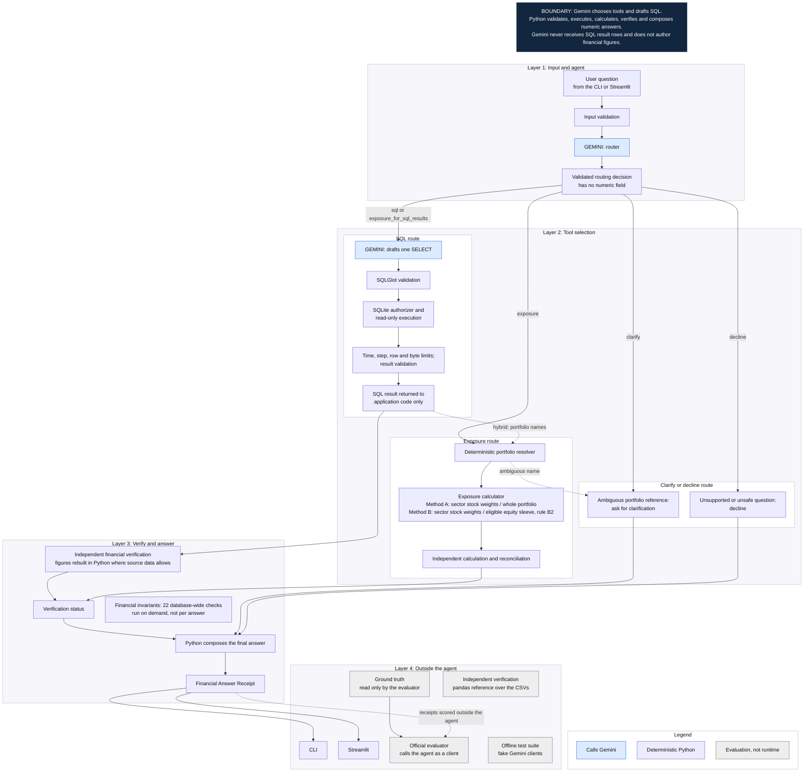
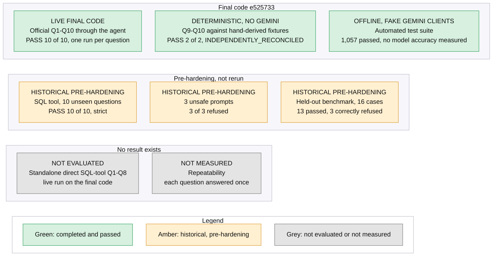

# PortfolioIQ

**An AI agent that answers plain-English questions about a portfolio database and shows how each answer was produced.**

Gemini chooses the tool and drafts the SQL. Python runs the SQL read-only, calculates every figure and writes every answer.
A command-line agent, an evaluator and an optional Streamlit app share the same backend.

## Assignment coverage

| Requirement | What it does | Start with |
|---|---|---|
| SQL Query Tool | Gemini turns a question into one `SELECT`, which is validated and run read-only | `src/portfolioiq/sql_tool.py`, `sql_guard.py` |
| Exposure Calculator | Sector exposure from `holdings.current_weight`, with bonds excluded | `src/portfolioiq/exposure.py` |
| Portfolio Agent (CLI) | Gemini chooses a tool, asks for clarification, or declines | `src/portfolioiq/agent.py`, `router.py`, `cli.py` |
| Agent Evaluator | Runs the ground truth through the agent and compares executed results | `src/portfolioiq_eval/official.py`, `comparator.py` |

**These eight files, about 2,500 lines, are the assignment.** The rest of the repository is independent verification, the optional
Streamlit app, tests and recorded evidence.

## Evaluator quick read

**Official Q1–Q10 Agent Evaluation: 10/10 PASS**, live on the final code ([report](reports/final_live/official_evaluation.md), [how it was run](reports/final_live/STATUS.md)).

| Evidence | Result | Type | Source |
|---|---|---|---|
| Official agent evaluation, Q1–Q10 | 10/10 PASS | Live, final code | [report](reports/final_live/official_evaluation.md) |
| SQL tool, unseen questions | 10/10 PASS | Live, pre-final-hardening | [report](reports/sprint_v2_3/candidate/sql_evaluation.md) |
| Unsafe prompts | 3/3 refused | Live, pre-final-hardening | [report](reports/sprint_v2_3/candidate/sql_evaluation.md) |
| Held-out benchmark, 16 cases | 13 passed, 3 correctly refused | Live, pre-final-hardening | [report](reports/heldout_v2_3/HELDOUT_RESULT.md) |
| Q9–Q10 deterministic calculations | 2/2 independently reconciled | No Gemini | [report](reports/final_live/official_evaluation.md), [fixtures](evaluation/fixtures/) |
| Offline test suite | 1,057 passed | Offline, fake Gemini clients | [results](reports/test_results.json) |
| Direct SQL-tool Q1–Q8 on the final code | `NOT EVALUATED` | Not run separately | [report](reports/final_live/official_evaluation.md) |
| Repeatability | `NOT MEASURED` | Each question answered once | [status](reports/final_live/STATUS.md) |

## Architecture



## Evaluation evidence map



## Evaluation results and how to interpret them

**Official Q1–Q10 Agent Evaluation: 10/10 PASS.** All ten supplied questions went through the complete agent workflow, and each result was compared
with the official reference. Q1–Q8 used the SQL route, and Q9–Q10 used the deterministic exposure calculator route. This is an end-to-end agent
evaluation, not a separate direct evaluation of the SQL tool.

Recorded configuration: `gemini-3.6-flash`, `candidate-2.3`, SQL prompt `314e91c11435`, router `676786d09950`, thinking LOW, response cache off. Code commit
`e52573335b0e92daef369d915f3983f5eaa4d653`, run on 9 November 2026 from 20:00 to 20:25 UTC. [Configuration manifest](reports/final_verification/eval_config_20261109T200056Z.json).

Each question was answered once, so repeatability was not measured. The prompt rules were written after studying earlier failures on the official and unseen
questions, so this is a successful development evaluation, not a blind benchmark.

| Evaluation | Configuration / timing | Execution mode | Scope | Result | What it proves |
|---|---|---|---|---|---|
| **A. Official agent evaluation** | `candidate-2.3`, final code `e525733` | Live Gemini 3.6 Flash, one run per question | Q1–Q10 end to end | **PASS 10/10**, ten recorded outcomes | The final agent routed and answered the ten supplied questions correctly in this run |
| **B. SQL tool, unseen** `HISTORICAL — PRE-FINAL-HARDENING` | `candidate-2.3`, before the final hardening | Live Gemini, strict comparison | 10 project-written questions | PASS 10/10 | The SQL tool answered them before hardening. Not rerun on the final code |
| **C. Unsafe prompts** `HISTORICAL — PRE-FINAL-HARDENING` | `candidate-2.3`, before the final hardening | Live Gemini | 3 unsafe prompts | 3/3 refused | The tool refused these prompts before hardening. Not rerun live on the final code |
| **D. Held-out benchmark** `HISTORICAL — PRE-FINAL-HARDENING` | `candidate-2.3`, before the final hardening, one run | Live Gemini | 16 frozen cases | 13 passed, 3 correctly refused | Behaviour on project-written cases that no prompt rule came from. The shape policy's false-positive check had seen their reference SQL, so it is not a blind benchmark |
| **E. Deterministic exposure** | Final code | No Gemini numeric generation | Q9–Q10 against hand-derived fixtures | PASS 2/2, `INDEPENDENTLY_RECONCILED` | The exposure calculation matches independently derived figures. Separate from the live routing result in A |
| **F. Offline tests** | Final code | Offline, fake Gemini clients | 1,057 tests | 1,057 passed | Deterministic code paths, security, financial calculations, routing and application behaviour. Not live Gemini accuracy |

**Offline test results and live Gemini evaluation results are different evidence types and must never be combined into one accuracy percentage.**

**The historical 8/10 result does not describe the final configuration. The final-code official agent evaluation passed all ten questions.** The original
configuration scored PASS 8, FAIL 2, and [that report](reports/sprint_v2_1/baseline/official_evaluation.md) is kept as historical evidence.

| Q1–Q8 scope | Final-code status |
|---|---|
| Through the complete agent | PASS 8 of 8 |
| Standalone direct SQL-tool live run | `NOT EVALUATED` |

That is a difference in scope, not an agent failure. A direct SQL-tool run scored 8 of 8 [before the final hardening](reports/sprint_v2_3/candidate/sql_evaluation.md), and it was not repeated.
For Q9–Q10, the live evaluation confirms routing and the fixture check confirms the calculation. They are two separate pieces of evidence.

### Provenance of the final live run

- **Requests.** The run took six sessions and [32 recorded requests](reports/final_live/api_usage.jsonl): 21 succeeded, 2 were 429 quota errors and 9 were 503 errors. Provider errors are infrastructure failures, not answers. Each question has one recorded answer.
- **API keys.** The ledger does not record which key served a request, so the number of keys is not established by the evidence. It has 21 successes in one UTC day, above the 20-request daily free-tier limit for one project, and successes continue after a quota error. The run should not be read as having fitted within one project's free-tier allowance.
- **Replay.** `official --replay-check` by default replays the responses recorded before the final hardening, and reproduces those receipts on the final code. It is not a check of the final live run, so use `--rescore` for that.
- **Model variation.** Compared with the recorded pre-hardening responses, the final run produced different SQL for Q3, Q6, Q7 and Q8, and different columns and answer text for Q6 and Q7. Both runs passed. This shows that output can vary; it is not a repeatability measurement.
- **Held-out file hash.** The held-out report cites the file's hash from before a later correction to its description field. No question or expected answer changed. See [the change record](evaluation/independent_benchmark_CHANGES.md).

## What the scores do not mean

1. The official agent's PASS 10/10 does not mean the standalone SQL tool was separately evaluated on the same final run.
2. The unseen, unsafe-prompt and held-out results were obtained before the final hardening.
3. Offline tests use fake Gemini responses and do not measure live model accuracy.
4. A correct refusal is a successful safety outcome, not an incorrect answer.
5. One successful run per question does not establish repeatability.
6. A successful SQL execution does not by itself establish financial correctness.
7. `INDEPENDENTLY_RECONCILED` applies only to calculations that were rebuilt and compared against an independent reference.

## Financial methodology

- **Exposure** uses `holdings.current_weight`, and bonds are excluded from named sector rows. Method A is each sector's stock weight over the whole portfolio. Method B is the same weight over the eligible equity sleeve.
- **Residual** is 100% minus all holding weights. It is shown as unattributed and is never treated as cash.
- **AUM** is the stated `total_aum`. Holdings cover only part of it, so market value is never called AUM.
- **Relative dates** are anchored to the latest date in the data, not today's date.
- **Q8's diversification ratio** is distinct stock sectors over all holdings, bonds included.

The frozen rules are in [docs/BUSINESS_RULES.md](docs/BUSINESS_RULES.md).

## Security architecture

Model output and user input are untrusted. Generated SQL passes two separate layers: a SQLGlot guard that allows one `SELECT` over approved tables, columns and functions, then SQLite itself
with a read-only connection, `query_only`, an authorizer and time, step, row and byte limits. This is not a certification of security. See [docs/SECURITY.md](docs/SECURITY.md) and [docs/SECURITY_AUDIT.md](docs/SECURITY_AUDIT.md).

## Quick start and reproducibility

Requires Python 3.12 or later.

```bash
git clone https://github.com/codebyAtharva09/PLCapital-PortfolioIQ.git
cd PLCapital-PortfolioIQ
python -m venv .venv
# Windows (PowerShell): .venv\Scripts\Activate.ps1      macOS/Linux: source .venv/bin/activate
python -m pip install -r requirements.txt
```

The database builds itself from `data/` on first use.

```bash
# The agent
python -m portfolioiq ask "How many portfolios do we have in total?"                              # live, needs a key
python -m portfolioiq ask --replay "How many holdings does the Dividend Aristocrats Fund have?"   # recorded responses, no key
python -m portfolioiq exposure "international equity"                                             # no Gemini, no key

# Score the recorded final-code live run again, with no key and no request
python -m portfolioiq_eval official --rescore --runs-dir reports/final_live/runs --reports-dir reports/rescore

# A new live evaluation, about 18 Gemini requests
python -m portfolioiq_eval official --max-requests 18

# Tests, the pandas reference and the optional app
pytest                                                                                            # offline, no key
python scripts/run_independent_verification.py                                                    # offline, no key
streamlit run app/streamlit_app.py                                                                # opens http://localhost:8501
```

Set the key with `$env:GEMINI_API_KEY = "<your key>"` (PowerShell) or `export GEMINI_API_KEY="<your key>"`, or put it in a git-ignored
`.env` file. Google's free tier allows 20 requests a day for `gemini-3.6-flash`.


## Known limitations

- The final live evaluation is one run per question on ten known questions, so it is not evidence of generalisation or repeatability.
- The 35 development and validation cases of the independent benchmark have not been run live ([report](docs/INDEPENDENT_BENCHMARK_REPORT.md)).
- Stored performance and risk figures can be checked for retrieval but cannot be recomputed from the supplied data.
- Frozen rule B2 excludes unclassified stocks from the Method B denominator. The supplied data has none, so no figure depends on this.
- It is a local, single-user, read-only tool with no authentication.

## Detailed reports

| Document | Contents |
|---|---|
| [reports/final_live/](reports/final_live/STATUS.md) | Final-code live evaluation: status, report and raw receipts |
| [docs/EVALUATION.md](docs/EVALUATION.md) | Evaluation methodology and historical results |
| [docs/DETAILS.md](docs/DETAILS.md) | Configuration, methodology, security, commands and layout |
| [docs/REVIEWER_GUIDE.md](docs/REVIEWER_GUIDE.md) | Five-minute walkthrough |
| [docs/INDEPENDENT_FINANCIAL_VERIFICATION.md](docs/INDEPENDENT_FINANCIAL_VERIFICATION.md) | Independent reference, inventory and unverifiable figures |
| [docs/BUSINESS_RULES.md](docs/BUSINESS_RULES.md) | Frozen financial and resolution rules |
| [docs/SECURITY_REGRESSION_REPORT.md](docs/SECURITY_REGRESSION_REPORT.md) | Security checks |
