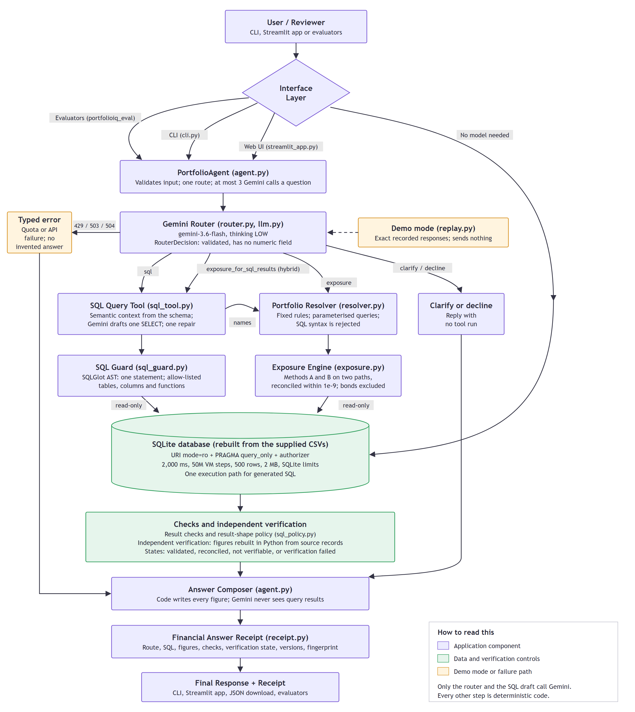

# PortfolioIQ

**An AI agent that answers plain-English questions about a portfolio database and shows how each answer was produced.**

Gemini chooses the tool and drafts the SQL. Python runs the SQL read-only, calculates every figure and writes every answer.
A command-line agent, an evaluator and an optional Streamlit app share the same backend.

> **Status.** On the final code, the active configuration (`candidate-2.3` on `gemini-3.6-flash`) scored **10 of 10** live on the official
> questions through the agent ([report](reports/final_live/official_evaluation.md), [how it was run](reports/final_live/STATUS.md)).


## Assignment coverage

| Requirement | What it does | Start with |
|---|---|---|
| SQL Query Tool | Gemini turns a question into one `SELECT`, which is validated and run read-only | `src/portfolioiq/sql_tool.py`, `sql_guard.py` |
| Exposure Calculator | Sector exposure from `holdings.current_weight`, with bonds excluded | `src/portfolioiq/exposure.py` |
| Portfolio Agent (CLI) | Gemini chooses a tool, asks for clarification, or declines | `src/portfolioiq/agent.py`, `router.py`, `cli.py` |
| Agent Evaluator | Runs the ground truth through the agent and compares executed results | `src/portfolioiq_eval/official.py`, `comparator.py` |

**These eight files, about 2,500 lines, are the assignment.** The rest of the repository is independent verification, the optional
Streamlit app, tests and recorded evidence.

## Quick start

Requires Python 3.12 or later.

```bash
git clone https://github.com/codebyAtharva09/PLCapital-PortfolioIQ.git
cd PLCapital-PortfolioIQ
python -m venv .venv
# Windows (PowerShell): .venv\Scripts\Activate.ps1      macOS/Linux: source .venv/bin/activate
python -m pip install -r requirements.txt
```

The database builds itself from `data/` on first use.

```bash
# The agent
python -m portfolioiq ask "How many portfolios do we have in total?"                              # live, needs a key
python -m portfolioiq ask --replay "How many holdings does the Dividend Aristocrats Fund have?"   # recorded responses, no key
python -m portfolioiq exposure "international equity"                                             # no Gemini, no key

# The evaluator: the ten ground-truth questions through the agent
python -m portfolioiq_eval official --max-requests 18                                             # live, about 18 Gemini requests
python -m portfolioiq_eval official --rescore                                                     # recorded live run, no key

# Tests and the optional app
pytest                                                                                            # offline, no key
streamlit run app/streamlit_app.py                                                                # opens http://localhost:8501
```

Set the key with `$env:GEMINI_API_KEY = "<your key>"` (PowerShell) or `export GEMINI_API_KEY="<your key>"`, or put it in a git-ignored
`.env` file. Google's free tier allows 20 requests a day for `gemini-3.6-flash`.

## How it works



Only the router and the SQL draft call Gemini, and Gemini never receives query results. Exposure uses `holdings.current_weight`, excludes
bonds, and reports each sector as a share of the whole portfolio and of the equity holdings.

## Results

| Evaluation (live, `gemini-3.6-flash`) | Result |
|---|---|
| **Official Q1-Q10 through the agent, final code** | **PASS 10** (the original configuration scored PASS 8, FAIL 2) |
| SQL tool, 10 unseen questions, strict, before the final hardening | PASS 10 |
| SQL tool, 3 unsafe prompts, before the final hardening | Refused 3 of 3 |
| Frozen held-out benchmark, 16 cases, before the final hardening | PASS 13, correctly refused 3 |

The offline suite passes 1,057 tests, using fakes in place of Gemini. Reports are in [reports/](reports/), and each live run keeps its raw
receipts.

## Known limitations

- The rules in the active SQL prompt were written after studying failures in the official and unseen sets, so those scores are development results.
- Each configuration was run once, so repeatability is unmeasured.
- It is a local, single-user, read-only tool with no authentication.

## More detail

[docs/DETAILS.md](docs/DETAILS.md) has the configuration, methodology, security design, full results, command reference and repository
layout. [docs/REVIEWER_GUIDE.md](docs/REVIEWER_GUIDE.md) is a five-minute walkthrough, and [docs/EVALUATION.md](docs/EVALUATION.md) has the
per-case evaluation.
