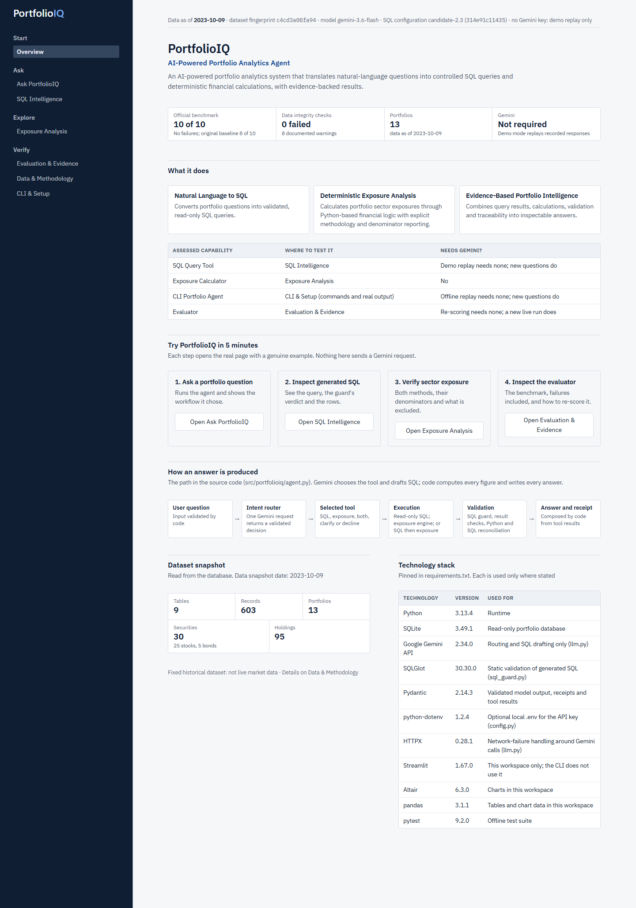
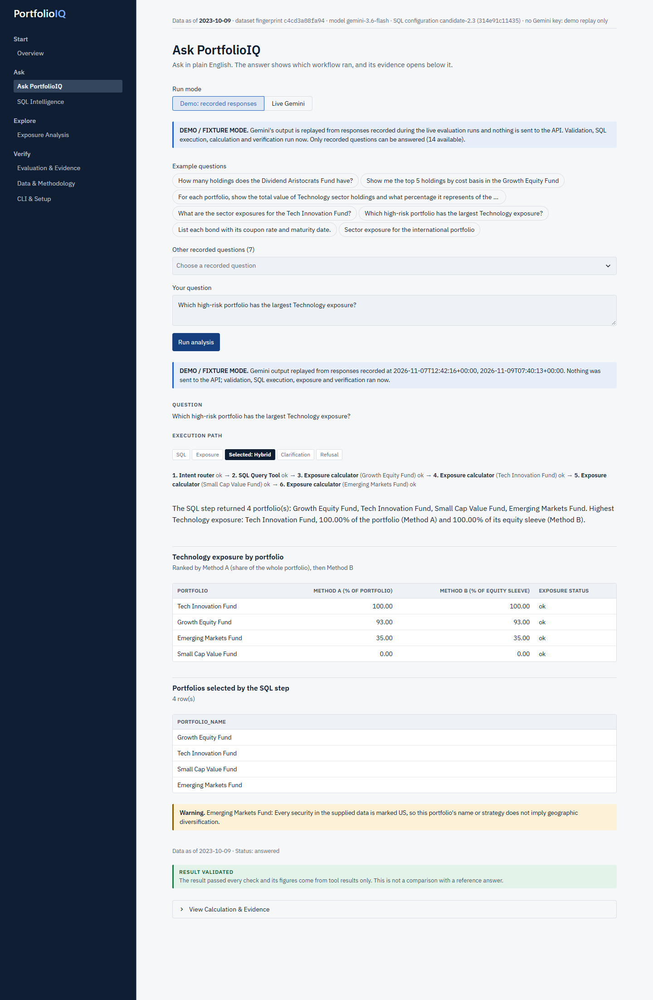
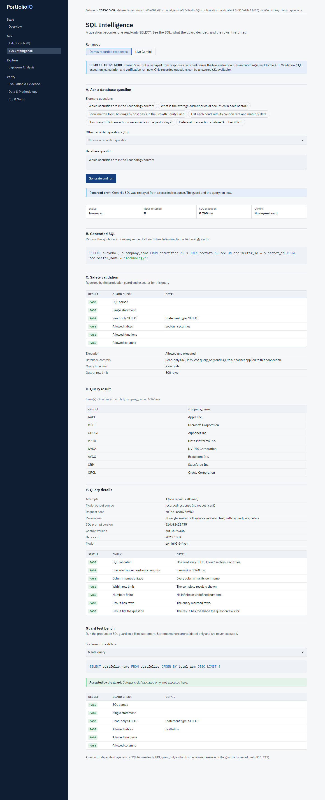
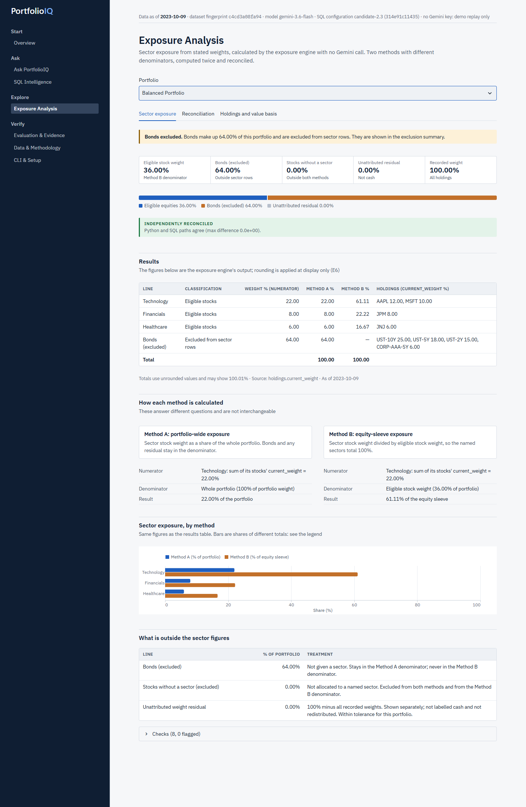
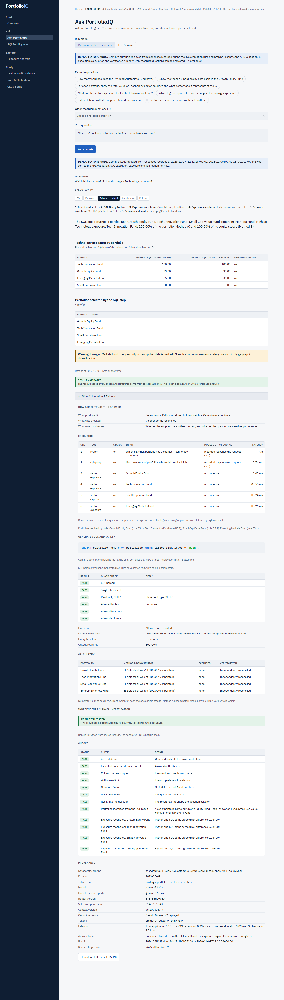
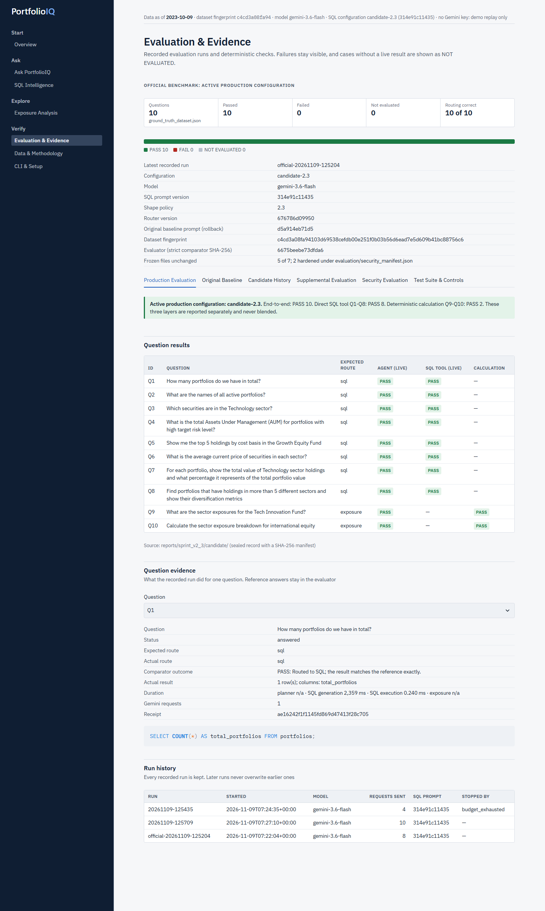
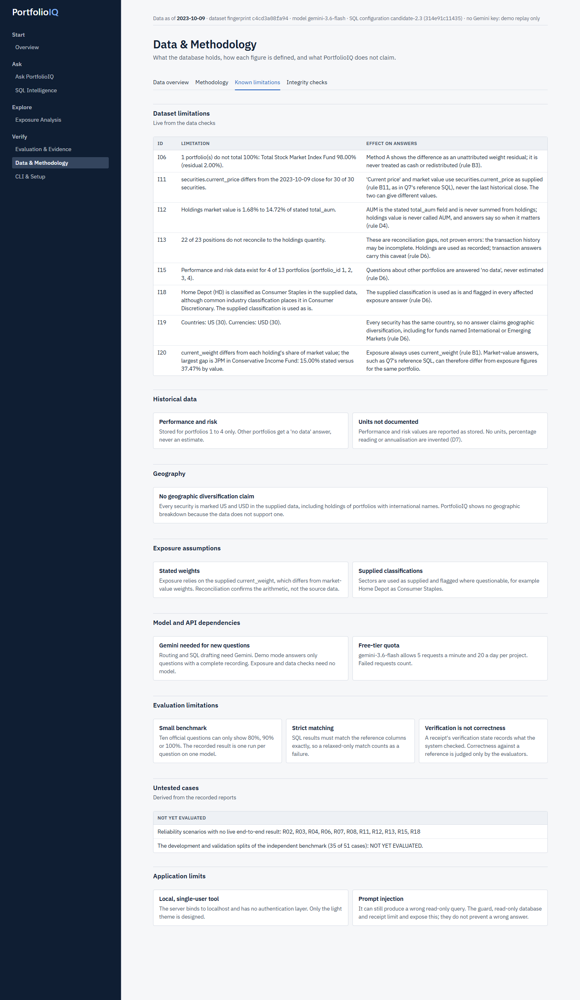
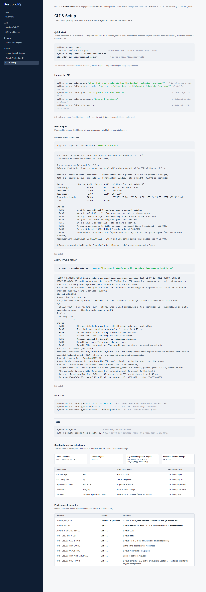

# Reviewer guide

Evaluate PortfolioIQ in about five minutes once it is running. No API key is needed for this path, and nothing on it sends a Gemini request.

## Start

Requires Python 3.12 or later. Tested on Python 3.12 and 3.13 on Windows 11.

```powershell
python -m venv .venv
.venv\Scripts\Activate.ps1
python -m pip install -r requirements.txt
streamlit run app/streamlit_app.py    # opens http://localhost:8501
```

The database builds itself from `data/` on first use. A key is needed only for new live questions: set `GEMINI_API_KEY` in the environment.

**Measured on 2026-11-09**, from a clean copy on Windows 11 with no key set: virtual environment 10 s, dependency install 194 s, first CLI answer 1 s, app healthy 4 s after that. **Total 3 min 29 s.** A package cache may have been warm and another test run was active on the machine. This did not meet a two-minute target, so setup should be budgeted at about four minutes on a similar connection.

## Five-minute path

| Step | Page | Do this | You should see |
|---|---|---|---|
| 1 | Overview | Read the first screen | What it does, the official result with its failures, the four capabilities |
| 2 | Ask PortfolioIQ | Press "Open Ask PortfolioIQ", then Run analysis | Selected workflow: Hybrid, ordered steps, the ranking, a DEMO label |
| 3 | Same page | Open **View Calculation & Evidence** | SQL, guard result, denominators, checks, dataset fingerprint, versions |
| 4 | SQL Intelligence | Choose an example, then Generate and run | The SQL, each guard check, rows, query details |
| 5 | Exposure Analysis | Choose Balanced Portfolio | Warnings first, then Method A 22.00% and Method B 61.11% Technology with denominators |
| 6 | CLI & Setup | Read the commands and output | Real CLI output produced by the page |
| 7 | Evaluation & Evidence | Open the tabs; in Test Suite & Controls, press Re-score | Active configuration PASS 10 reproduced offline; Original Baseline tab shows the historical PASS 8, FAIL 2, which does not describe the final configuration; candidate history, supplemental and security kept apart |
| 8 | Data & Methodology | Open Known limitations | Data limits, untested cases, model dependencies |

The active SQL configuration is `candidate-2.3` (SQL prompt `314e91c11435`). `PORTFOLIOIQ_SQL_PROMPT=baseline` restores the original configuration. Held-out T01-T16 scored 16 of 16 in one run; the other 35 independent cases are NOT YET EVALUATED.

Demo mode replays recorded Gemini responses and labels them DEMO / FIXTURE MODE; validation, SQL execution, calculation and verification run live. Unrecorded questions get a plain "not recorded" reply, with nothing invented.

## Screenshots

From the running application, with no key configured, using real database results.

**Overview**



**Ask PortfolioIQ (demo replay)**



**SQL Intelligence**



**Exposure Analysis**



**Financial Answer Receipt**



**Evaluation & Evidence**



**Known limitations**



**CLI & Setup**



## Acceptance results, 2026-11-09

These were checked by a script driving the real app in Chrome, with real clicks and assertions on visible text. **No person was timed**, so the 30-second and 5-minute reading goals are not measured.

| Test | Result |
|---|---|
| A: opening page identifies the product, architecture, four capabilities and how to start | Passed (content check) |
| B: start from a clean copy | Completed in 3 min 29 s; two-minute target not met |
| C: SQL tool, exposure, CLI, evaluator | Passed in demo mode; scripted walk took 44 s |
| D: tool, result, evidence, method, denominator, warnings, dataset visible | Passed for the hybrid example |
| E: limitations visible | Passed |

Live Gemini mode was not exercised, in order not to spend quota. Its failure messages are covered by tests with simulated errors.
